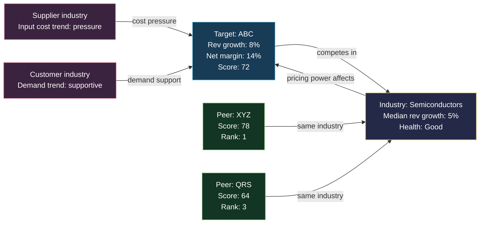

# Scoring And Mermaid Diagram Rules

For the portfolio-analyzer application, use [the implemented formula and review
guide](portfolio-analyzer-formula.md) to audit current behavior. The weights and
bands below are general design recommendations; they are not a claim that every
part is implemented in the active application model.

## Scoring Model

Use a 0-100 score. Keep the score explainable and deterministic.

Recommended weights:

- Company fundamentals, 45 points:
  - Revenue growth vs peer median: 12
  - Net income or operating income growth vs peer median: 10
  - Margin level vs peer median: 10
  - Margin stability/improvement: 5
  - Free cash flow quality: 5
  - Balance sheet/debt pressure: 3
- Industry outlook, 25 points:
  - Peer median revenue growth: 8
  - Peer median profit growth: 6
  - Peer median margin: 5
  - Demand/guidance/risk-factor consistency: 4
  - Data breadth: 2
- Related-industry effect, 15 points:
  - Supplier/input cost tailwind or pressure: 5
  - Customer-demand tailwind or pressure: 5
  - Substitute/complement/regulatory/capital effect: 5
- Relative rank and confidence, 15 points:
  - Rank among peers: 8
  - Number and quality of source reports: 4
  - Missing-data penalty: 3

Bands:

- 80-100: Strong, better positioned than most peers.
- 65-79: Good, likely competitive but with watch items.
- 50-64: Mixed, not clearly better than peers.
- 35-49: Weak, reports show important pressure.
- 0-34: Insufficient or poor outlook.

Finance professional adjustments:

- Organic growth: discount revenue growth when mostly acquired or FX-driven unless acquisition quality is clear.
- Cash conversion: penalize earnings growth without operating cash flow support.
- Working capital: flag growth funded by receivable/inventory stretch.
- Leverage: penalize rising debt, weak interest coverage, or refinancing exposure.
- Cyclicality: compare against cycle position; do not over-score peak margins in cyclical industries.
- Segment mix: give credit when higher-margin or faster-growing segments are becoming larger.
- Dilution: penalize per-share value when share count rises materially.
- One-offs: normalize restructuring, asset sales, tax effects, litigation, impairments, and discontinued operations when disclosed.

Confidence:

- High: target plus at least 4 same-industry peers, 3+ years, cash-flow and balance-sheet data available.
- Medium: target plus 2-3 peers or some missing metrics.
- Low: no same-industry peers, only one-year data, or major missing report fields.

## Prediction Scorecard

When an app saves predictions, store the exact baseline used at prediction time. Never overwrite the original thesis or diagram.

Prediction direction:

- `positive`: score >= 65 or thesis says the company should outperform peers.
- `neutral`: score 50-64 or thesis says performance should be in line.
- `negative`: score < 50 or thesis says the company should underperform.

Actual direction after a later report:

- Compare the next available annual or quarterly report against the saved baseline.
- Use actual revenue growth, profit growth, margin movement, FCF direction, and peer-relative rank.
- Mark as `pending` if no newer report is available.
- Mark as `inconclusive` if material metrics are missing or restated.

Accuracy score:

- 100: direction and main thesis were correct.
- 75: direction was correct but magnitude or one major driver was wrong.
- 50: neutral or mixed result.
- 25: partially wrong; one signal correct but conclusion wrong.
- 0: direction and thesis were wrong.

Track aggregate accuracy by:

- Symbol.
- Industry.
- Horizon, such as 3 months, 6 months, 1 year.
- Model/scoring version.
- Confidence band at prediction time.

Use these aggregates to improve weights. Do not automatically change scoring weights without showing before/after accuracy and sample size.

## Mermaid Diagram Rules

Use `flowchart LR` for relation maps. Use `flowchart TD` only when the user wants a vertical diagram.

Hard constraints:

- Maximum 3 feedback loops/cycles.
- Maximum 14 nodes unless the user asks for more.
- Maximum 22 edges unless the user asks for more.
- Every edge must have a short label.
- Include finance numbers in important node labels, for example revenue growth, net margin, score, or peer rank.
- Do not include raw secrets, API keys, or private account data.

Loop definition:

- A loop is a directed cycle such as `A --> B --> C --> A`.
- Count only causal cycles, not repeated visual groups.
- If more than 3 loops are needed, collapse extra details into one grouped node like `Other related industries`.

Loop audit before returning Mermaid:

1. List every directed edge as `from -> to`.
2. Identify cycles by walking from each node back to itself.
3. Count only unique causal cycles.
4. If cycle count is above 3, remove detail edges or collapse nodes until the count is 3 or less.
5. Prefer no loops when the diagram is only a comparison map; use loops only for causal feedback such as demand, pricing, supplier cost, or capital-cycle effects.

Recommended graph structure:



Professional diagram guidance:

- Put the target company near the center or left-center.
- Put same-industry peers around the industry node.
- Put related industries on the outside feeding into the target or industry.
- Use color classes by node type, not random colors.
- Keep labels readable; use `<br/>` for numeric lines.

## Implementation JSON Shape

Recommended API response:

```json
{
  "symbol": "ABC",
  "companies": [],
  "industry": {
    "name": "Industry",
    "median_revenue_growth_percent": 0,
    "median_net_margin_percent": 0,
    "score": 0,
    "issues": []
  },
  "related_industries": [],
  "graph": {"nodes": [], "edges": []},
  "mermaid": "flowchart LR\\n...",
  "score": 0,
  "score_components": {},
  "confidence": "Medium",
  "conclusion": "",
  "simple_words": [],
  "prediction_record": {
    "id": "",
    "horizon_date": "",
    "baseline_fiscal_date": "",
    "status": "pending"
  },
  "missing": [],
  "provider_status": {}
}
```

## Simple Words Template

Use this pattern:

`ABC scores 72/100. It ranks 2 out of 6 peers. The industry is healthy because peer revenue and margins are still growing. Supplier costs are a risk, but customer demand looks supportive. ABC is not the top company, but it appears better positioned than the average peer because revenue growth and margins are above the group median. Confidence: Medium.`
