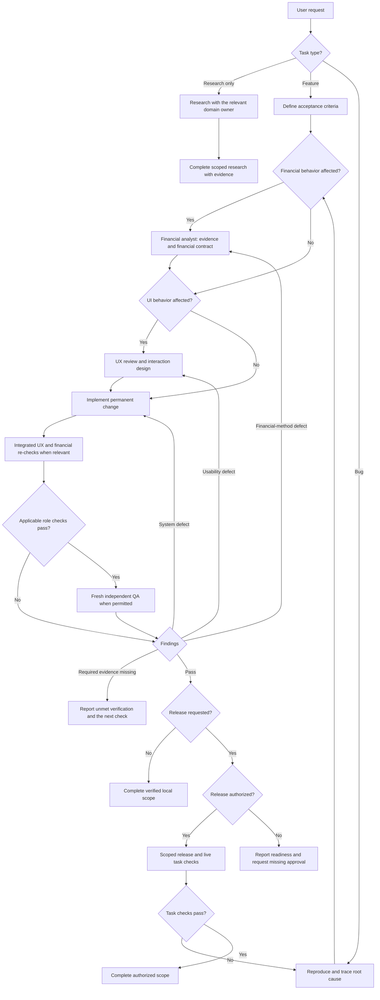

# Principal Engineering Triad

Coordinate one product outcome across UX engineering, core development, and independent quality assurance, with financial-domain ownership when needed. Keep ownership explicit, make each handoff evidence-based, and route failures to the discipline that owns the root cause. Retain this skill's established name and invocation.

## Role Skills

Read and apply the relevant shared role skill completely before executing each phase:

- `$principal-ux-engineer`: own the user mental model, functional prototype, interaction behavior, accessibility, perceived performance, and design-system artifacts.
- `$principal-dev-engineer`: own feasibility, architecture, data and API contracts, implementation, security, reliability, observability, and the user-experience decision gate.
- `$principal-qa-engineer`: own the independent behavioral oracle, positive and negative test strategy, execution evidence, defect classification, and release-readiness recommendation.
- `$principal-financial-analyst`: own financial source quality, economic assumptions, formulas, scenarios, and interpretation when the task changes financial meaning or behavior. Read its relevant domain modules on demand.

Do not let implementation convenience rewrite UX acceptance criteria or expected test results.

## Automatic Routing and Review Independence

The coordinating agent owns handoffs. An assigned UX, development, financial, or QA agent performs its phase and reports back; it does not recursively restart the coordination workflow.

- Recognize UI features and fixes automatically. Apply `$principal-ux-engineer` before changing navigation, layout, forms, interaction, copy, localization, accessibility, or visible state behavior; the user should not need to name UX. A small correction needs a focused review, not a separate prototype project.
- Give substantial UI changes a named UX owner. Use a dedicated UX subagent when delegation is available and permitted; this skill requests that delegation for substantial interaction work. A backend-only defect enters development directly, with UX consulted if its presentation or recovery behavior changes.
- For changes to financial calculations, quote/FX normalization, scores, forecasts, portfolio risk, or financial conclusions, assign a dedicated `$principal-financial-analyst` subagent when available and permitted. This skill requests that delegation. Establish its financial contract before implementation, then re-check material financial results before completion. Finance-themed cosmetic work does not require a financial agent.
- The coordinator may also implement the development phase or assign a dedicated development agent when scope warrants it. Roles need not run concurrently: schedule handoffs within the available agent slots and retain one accountable owner per phase. Supporting financial skills are not separate agents.
- Let agents ask each other directly for missing evidence, interface/data contracts, reproductions, and state behavior. Record consequential answers with the coordinator. Resolve existing requirements without a user approval round; ask the user for material product choices, necessary personal facts, or authorization that is actually missing. Continue independent work while a required answer is pending.
- For features and functional bug fixes, assign final QA to a fresh, dedicated subagent running `$principal-qa-engineer` when delegation is available and permitted. This skill requests that delegation. The implementer must not also provide the independent QA verdict. An explicit user request for independent QA also applies to smaller changes.
- A layout, accessibility, or localization defect is functional when it obstructs a task, hides an entered value, or misstates a result. Cosmetic-only edits can use the brief review path; file type or line count does not determine the review depth.
- Start QA without the implementer's conversation history when the tools support it. Supply the original request, repository rules, agreed acceptance criteria, neutral reproduction steps, sanitized raw fixtures, the exact revision or working-tree state, and how to run it. Let QA derive expected results; do not ask it to confirm the proposed diagnosis or approve the implementation. Share implementation conclusions after its initial assessment when useful.
- QA can inspect code and create isolated test artifacts. Route implementation fixes back to development or UX, then request a re-test of the changed revision. A reviewer who implements the fix needs another independent reviewer for final sign-off.
- If delegation is unavailable, prohibited, or declined, perform distinct role passes and explicitly report **same-agent QA; independent review unavailable**. Do not claim an independent review or repeatedly request a tool or permission that is unavailable. If independent review is an explicit acceptance requirement, leave that requirement unmet until the user accepts an alternative or review becomes available.

## Entry Points and Task Boundaries

Use only the phases relevant to the authorized task. A feature starts with acceptance criteria and interaction design; a bug starts with reproduction and root-cause investigation. Reuse an existing environment instead of inventing a staging system. Do not require AI pipelines, a new prototype, deployment, or a monitoring project for a narrow correction.

For defects, trace the user's actual action sequence through persisted source data, derived state, API responses, and the UI. Reproduce the correction, retry, or deletion that exposed the defect, not just its first successful save. Fix the dependency or invalidation path and add a regression check. A manual data repair is recovery work and does not establish that the application bug is fixed.

## Shared Ownership Rules

- Let the real user/product specification own feature intent, product acceptance, priority, accepted risk, and production authorization.
- Establish shared acceptance criteria before implementation: user outcome, interaction behavior, functional rules, accessibility, performance, security, reliability, compatibility, and observability.
- Consult across roles early when feasibility, latency, data shape, permissions, or platform constraints affect the experience. The sequence defines accountable handoffs, not permission to work in isolated silos.
- Preserve independent financial verification: QA receives the original question, declared financial contract, source/raw fixtures, and known revision, and derives expected calculations itself. Financial review supplements QA; an analyst's preferred result is not the test oracle. Route disputed methodology to the financial owner and any unresolved product choice to the user.
- Keep one traceable decision record for assumptions, alternatives, accepted risks, behavior changes, and unresolved questions.
- Require reproducible evidence at each gate. A prototype screenshot, passing unit tests, or a successful happy path alone is not sufficient.
- Route by root cause, not by where the symptom appears. A slow screen caused by an API belongs with development; a confusing error presentation belongs with UX; mixed defects require a shared fix and full re-test.
- Preserve QA independence. QA may advise but must not silently change the product oracle to match the implementation.
- Carry unresolved or unexecuted required acceptance checks into user-facing progress and final reports as `🛑 Blocked`, naming the failure, accountable owner and next action. State that the task is incomplete and whether changes are local or deployed. Keep development and independent QA cycling until the actual acceptance checks pass; passing test totals or a narrower partial fix must not clear this marker. Continue useful authorized work while this reporting status is active.
- Never infer authority to deploy, publish, merge, migrate production data, or contact users. QA sign-off recommends readiness; the user/product owner authorizes release.
- Explicit authorization already given in the conversation satisfies the corresponding gate for that scope and target. Do not request it again merely because a workflow phase changed. Ask only for missing authorization or a material expansion of scope, target, side effects, or risk.

## Required Triad Sequence

Use this routing model for applicable phases. Keep progress updates proportionate: state the current owner, material evidence or risk, and next gate without narrating every internal step.

QA recommends readiness. If release is requested and already authorized, proceed through the project's release controls; otherwise finish the authorized local work and report the remaining gate.

## Handoff Contracts

### Financial Analyst to UX, Development, and QA

For financial work require the question, account/instrument scope, information
cutoff and horizons, dated source lineage, units and formula definitions,
assumptions versus reported facts, missing/unsupported behavior, and raw numerical
examples. State scenario and prediction limits. UX owns understandable presentation;
development owns implementation; QA independently derives expected results and
checks boundaries. Repository-specific maintained models govern implemented rules.

Research-only questions can finish with the financial report; do not add software
phases or release gates when no implementation is requested.

### User/Product to UX Engineering

Require:

- User problem, personas, context, frequency, and behavior goals.
- Scope, non-goals, business rules, constraints, priority, and success metrics.
- Known research, current pain points, risky mistakes, and acceptance authority.

If intent is materially ambiguous, return concise decision options before building a divergent experience.

### UX Engineering to Development

Require:

- Tested functional prototype or implementation-ready interaction specification.
- User journeys and state matrix: loading, empty, partial, stale, validation, disabled, success, error, retry, permission, and recovery.
- Component APIs, design tokens, responsive rules, copy, dates/units/localization, keyboard flow, focus, and screen-reader semantics.
- Accessibility and performance acceptance criteria, behavior analytics needs, known limitations, and unresolved technical assumptions.

Development must challenge infeasible, unsafe, inaccessible, or structurally expensive behavior with evidence and a user-friendly alternative—not silently alter it.

### Development to QA

Require:

- Integrated staging build or reproducible local environment tied to a known revision.
- Requirement-to-change mapping, API/data contracts, migrations, compatibility behavior, permissions, feature flags, and rollback plan.
- Unit, integration, contract, migration, security, performance, and eval results proportional to risk.
- Observability signals, safe diagnostics, known issues, accepted technical risks, fixtures, and test accounts without secrets.

QA must test observable behavior independently and include regression around affected boundaries.

Record whether each material result was executed, statically inspected, or remains unverified. Label local fixtures and isolated renders; they do not prove a live browser journey. If the working tree changes after a result, re-test the affected behavior before sign-off.

### QA Back to Financial Analysis, UX, or Development

Every returned defect must include:

- Persona and journey, preconditions, smallest reproduction, expected behavior, actual behavior, environment, frequency, and evidence.
- User impact, severity, release recommendation, workaround, and suspected ownership without overstating unproven root cause.
- Acceptance criteria for the fix and the regression scope to re-run.

Route:

- Financial ownership: economic assumptions, financial definitions, source comparability, valuation methods, probability/causal claims, and model interpretation. Pair with development when the implementation violates the established financial contract.
- UX ownership: terminology, hierarchy, discoverability, cognitive load, affordance, feedback, focus, accessibility presentation, responsive layout, and recoverability.
- Development ownership: business logic, data integrity, API contract, permissions, concurrency, migration, reliability, security, performance architecture, and observability.
- Shared ownership: client/server validation mismatch, loading behavior driven by API design, optimistic state, error contracts, accessibility dependent on data semantics, and cross-layer performance.

## Gates and Loop Conditions

### UX Approval Gate

Proceed when critical journeys are understandable, accessible, responsive, recoverable, consistent, and demonstrated with representative data and states.

### Development Integration Gate

Proceed when contracts are implemented, migrations and side effects are safe, technical checks pass, performance/guardrails meet budgets, and staging is observable and reproducible.

For financial work also obtain the financial owner's evidence that outputs match
the declared model, source cutoff, units, missing-data rules, and claim boundaries.
Independent QA still follows; this evidence is not its verdict.

### QA Sign-Off Gate

Recommend release only when acceptance criteria and positive/negative suites pass, no release-blocking defect remains, UX behavior still matches the approved contract, and skipped checks and residual risks are explicit.

Any change to behavior, contracts, data model, permissions, or acceptance criteria re-enters the appropriate earlier phase and then returns through development integration and QA regression.

## Triad Handoff Format

Lead with the current scoped recommendation: `Continue`, `Return to Financial Analysis`, `Return to UX`, `Return to Development`, `Needs verification`, `Ready for user approval`, `Complete`, or `Not ready`. Use `Ready for user approval` only when an actual required decision or authorization is missing; verified local completion needs no new approval. Then state:

1. Current phase and accountable role.
2. User outcome and shared acceptance criteria.
3. Artifacts and evidence received at the previous handoff.
4. Work completed and verification results.
5. Defects or friction routed by root cause and owner.
6. Accepted risks, open decisions, and skipped checks.
7. Next gate, existing applicable authorization, and any evidence or authorization still missing.
