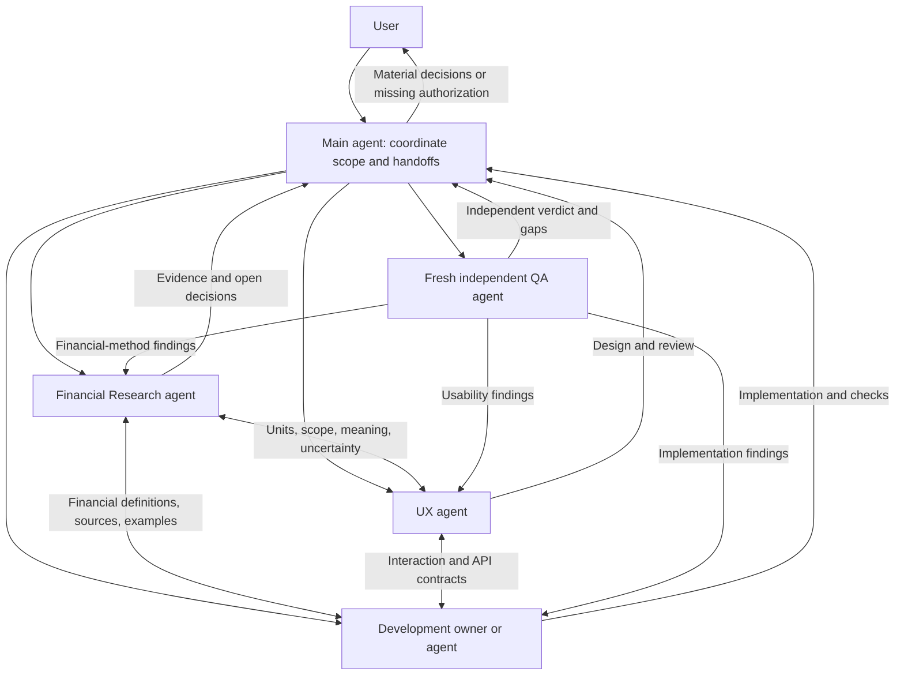

# Agent Relationships

The coordinator owns scope and handoffs. Dedicated role agents communicate
directly for needed evidence and contracts, report consequential decisions to the
coordinator, and return defects to their owner. QA starts from requirements and
raw evidence independently. Supporting financial skills are loaded by the analyst;
they are not additional agents. Schedule phases within the available active slots.

For financial implementation: financial contract and UX where relevant, then
development, financial re-check, and independent QA. Re-test changed behavior
after findings. Pure financial research can finish without an engineering cycle.
Cosmetic-only edits use focused review. Research/QA readiness grants no release
authority; existing explicit authorization remains valid for its scope.
